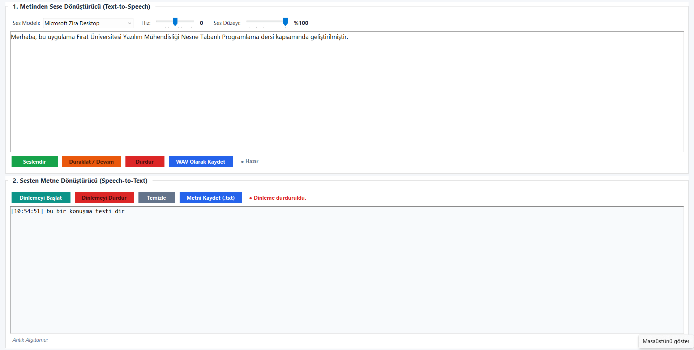

# YMH 219 - Speech-to-Text & Text-to-Speech Masaüstü Uygulaması

**Öğrenci Adı Soyadı:** Yusuf Tuğra Deveci  
**Öğrenci Numarası:** 250541095  
**Ders:** YMH 219 - Nesne Tabanlı Programlama

## Proje Açıklaması
Fırat Üniversitesi Yazılım Mühendisliği Bölümü **YMH 219 - Nesne Tabanlı Programlama** dersi kapsamında C# ve .NET Windows Forms kullanılarak geliştirilmiş çift yönlü Türkçe ses işleme uygulamasıdır.

## Kullanılan Teknolojiler ve NuGet Paketleri
- **C# / .NET Windows Forms**
- **System.Speech:** Metinden sese (Text-to-Speech) dönüştürme ve `.wav` dışa aktarma
- **Vosk (`vosk-model-small-tr-0.3`):** İnternet bağlantısı gerektirmeyen çevrimdışı Türkçe konuşma tanıma (Speech-to-Text)
- **NAudio:** Mikrofon üzerinden gerçek zamanlı ses yakalama

## Kurulum ve Çalıştırma Adımları
1. Depoyu bilgisayarınıza klonlayın: `git clone [https://github.com/yusuftugradeveci23/YMH219-SpeechApp.git](https://github.com/yusuftugradeveci23/YMH219-SpeechApp.git)`
2. [Vosk Türkçe Küçük Model (`vosk-model-small-tr-0.3`)](https://alphacephei.com/vosk/models/vosk-model-small-tr-0.3.zip) arşivini indirip çıkarın ve klasörü `YMH219-SpeechApp/vosk-model-small-tr-0.3` dizinine yerleştirin.
3. Visual Studio ile çözümü açıp derleyin ve çalıştırın (`F5`).

## Uygulamanın Temel Özellikleri
- **Metinden Sese (TTS):** Yüklü Türkçe/İngilizce ses modelleri (Microsoft Tolga, Zira vb.) arasında seçim, konuşma hızı ve ses düzeyi ayarı, başlatma, duraklatma/devam ettirme, durdurma ve `.wav` ses dosyası olarak kaydetme.
- **Sesten Metne (STT):** Mikrofondan alınan Türkçe konuşmayı gerçek zamanlı olarak zaman damgasıyla metne dökme ve `.txt` dosyası olarak kaydetme.

## Ekran Görüntüleri

### 1. Türkçe Konuşma Tanıma ve Seslendirme Görünümü

### 2. Konuşma Testi ve Ses Modeli Seçimi Görünümü

## Bilinen Sınırlamalar / Geliştirme Notları
- Çevrimdışı Türkçe konuşma tanıma modeli (`vosk-model-small-tr-0.3`) dosya boyutu nedeniyle depoya dahil edilmemiştir; kurulum adımlarındaki bağlantıdan indirilerek proje dizinine eklenmelidir.
