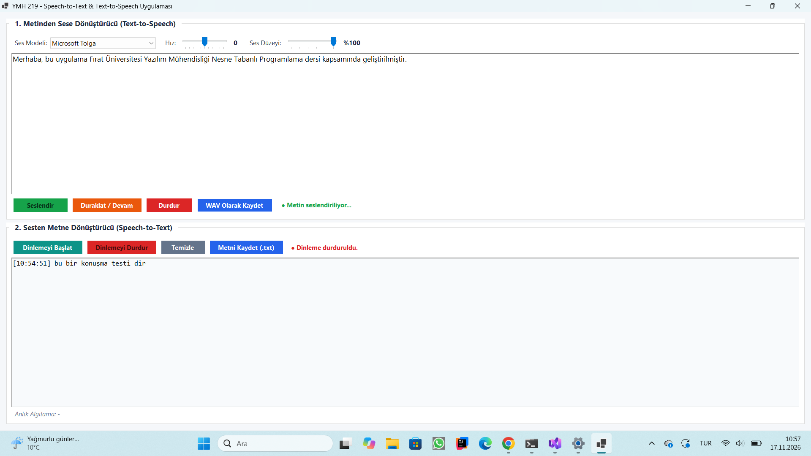

# YMH 219 - Speech-to-Text & Text-to-Speech Masaüstü Uygulaması

Fırat Üniversitesi Yazılım Mühendisliği Bölümü **YMH 219 - Nesne Tabanlı Programlama** dersi kapsamında C# ve .NET Windows Forms kullanılarak geliştirilmiş çift yönlü Türkçe ses işleme uygulamasıdır.

## Özellikler
- **Metinden Sese (TTS):** Microsoft Tolga/Zira ses modelleri, hız ve ses düzeyi ayarı, .wav olarak kaydetme.
- **Sesten Metne (STT):** Vosk Offline AI Türkçe modeli (osk-model-small-tr-0.3) ve NAudio ile internet gerektirmeden gerçek zamanlı Türkçe konuşma tanıma, .txt olarak kaydetme.

## Kurulum ve Çalıştırma
1. Depoyu klonlayın: git clone https://github.com/yusuftugradeveci23/YMH219-SpeechApp.git
2. [Vosk Türkçe Küçük Model](https://alphacephei.com/vosk/models/vosk-model-small-tr-0.3.zip) arşivini indirip çıkarın ve YMH219-SpeechApp/vosk-model-small-tr-0.3 dizinine yerleştirin.
3. Visual Studio ile projeyi açıp çalıştırın (F5).

## Ekran Görüntüsü

